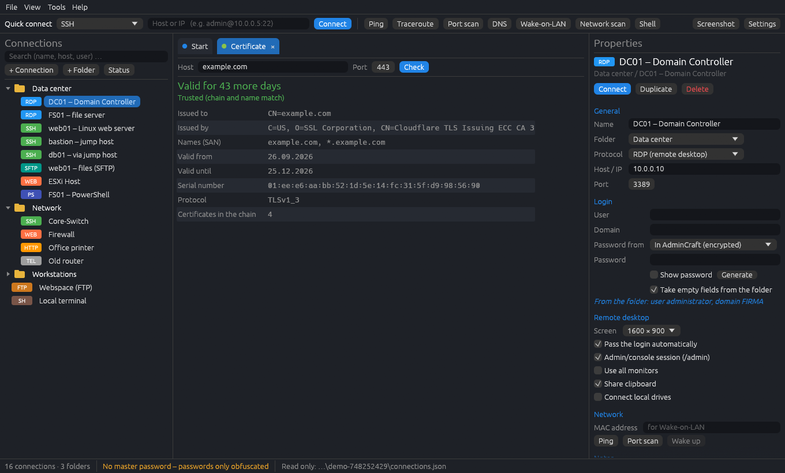

<h1 align="center">AdminCraft</h1>

<p align="center">
  <b>A portable remote connection manager and admin toolbox, built in pure Rust.</b>
</p>

<p align="center">
  RDP, SSH, VNC, Telnet, PowerShell, serial consoles and file transfer in tabs, plus the everyday
  tools of a sysadmin — in one small program that runs from a USB stick on Windows, Linux and macOS.<br>
  <i>Built with CraftAnything.</i>
</p>

<p align="center">
  
  
  
  
</p>

<p align="center">
  <a href="#a-look-around">A look around</a> ·
  <a href="#features">Features</a> ·
  <a href="#quick-start">Quick start</a> ·
  <a href="#portable-and-private">Portable and private</a> ·
  <a href="#building">Building</a> ·
  <a href="#roadmap">Roadmap</a> ·
  <a href="#license-and-credits">License and credits</a> ·
  <a href="docs/README.de.md">Deutsch</a>
</p>

<br>

<p align="center">
  
</p>

## A look around

<table>
<tr>
<td width="50%" valign="top"><p align="center"><sub><b>Certificate check.</b> How long is HTTPS still valid, who issued it, is it trusted?</sub></p></td>
<td width="50%" valign="top"><p align="center"><sub><b>Subnet calculator.</b> Network, mask, broadcast and usable range — one click to scan it.</sub></p></td>
</tr>
<tr>
<td colspan="2" valign="top"><p align="center"><sub><b>Export for a colleague</b> — without passwords, encrypted with an export password, or (after a clear warning) in plain text.</sub></p></td>
</tr>
</table>

## Features

**Connections**
- Tree of folders and connections with search, drag & drop, duplicate, and folders that pass
  user / domain / password on to everything inside.
- **In a tab:** SSH (OpenSSH), Telnet, PowerShell Remoting, local shell, serial console, raw TCP, rlogin.
- **Window in a tab (Windows):** Remote Desktop (mstsc, automatic login), PuTTY, VNC viewers and web
  interfaces (Edge/Chrome app window) are embedded into the tab; a click gives them the keyboard.
- **Jump hosts:** log in to a jump host and continue there with `ssh user@target` (the key can live
  on the jump host), or tunnel with `ssh -J`; works in the terminal tab, with PuTTY and in an own window.
- **SSH tunnels** (port forwarding) per connection, started by hand or together with the connection.
- **Multi-input:** type into several terminal tabs at once; **saved commands** with placeholders.
- Tabs can be renamed and reordered; screenshot of the active tab to the clipboard.

**Files**
- Two-pane file transfer for **SFTP, SCP, FTP and FTPS** — upload and download (also folders),
  create, rename, delete, drag files in from the explorer. Through OpenSSH or PuTTY's psftp/pscp.

**Passwords**
- Stored encrypted (AES-256-GCM, optional master password), read from a **KeePass/KeePassXC** database,
  or asked every time. **2FA codes (TOTP)** from KeePass entries, password generator.
- The whole list can be encrypted with the master password and kept centrally on a
  **network share (SMB)** or a **WebDAV server** (Nextcloud, ownCloud …); changes by others are reloaded.
- **Export / import** to hand connections to a colleague — with or without passwords.

**Admin tools**
- **Network scanner** (in the spirit of Angry IP Scanner): ping and port checks over an IP range,
  names, MAC addresses; save a baseline and see what is **new, gone or changed** on the next scan.
- Ping / traceroute, port scan, DNS lookup (A, AAAA, MX, TXT, CNAME, NS, SOA, PTR, SRV, CAA),
  Wake-on-LAN, subnet calculator, TLS certificate check, reachability monitoring with alerts.
- Windows management per right-click (services, event viewer, computer management, `C$`),
  restart / shut down (Windows via `shutdown /m`, Linux via `sudo reboot` over SSH).

**More**
- Import from **mRemoteNG** (`confCons.xml`) and OpenSSH (`~/.ssh/config`, including ProxyJump).
- German and English built in, more languages as plain text files (`AdminCraftLang/xx.lang`);
  the system language is used by default.
- A settings page for the paths of helper programs, or simply drop portable programs such as
  `putty.exe` into the `AdminCraftTools` folder next to AdminCraft.

## Quick start

1. Download `AdminCraft.exe` from the [releases](../../releases) (or [build it](#building)).
2. Put it into any folder — a USB stick is fine — and start it.
3. Double-click an example connection, or create your own with **+ Connection**.

Helper programs AdminCraft can use: OpenSSH (built into Windows 10/11, macOS and Linux), `mstsc`
(Windows), FreeRDP or Remmina (Linux), a VNC viewer, PuTTY. The start page shows what was found.

## Portable and private

- Everything lives next to the program: `AdminCraftData` (connections, scans, logs),
  `AdminCraftTools` (helper programs), `AdminCraftLang` (own languages). Copy the folder, done.
  If that folder can't be written (e.g. inside a macOS app bundle), `~/.admincraft` is used.
- Passwords never leave the computer unencrypted unless you explicitly export them in plain text.
- AdminCraft talks to nothing on the internet by itself; it only connects where you tell it to.

## Building

Rust from [rustup.rs](https://rustup.rs), then:

```sh
cargo build --release      # target/release/admincraft(.exe)
cargo test
```

- **Windows:** the default MSVC toolchain works. Without Visual Studio, the
  `x86_64-pc-windows-gnullvm` toolchain with LLVM-MinGW works too (see `.cargo/config.toml`).
- **Linux:** `pkg-config libxkbcommon-dev libwayland-dev libx11-dev libgl1-mesa-dev` and a C compiler.
- **macOS:** the Xcode command line tools.

Command line for checks: `--screenshot <file.png>` (draws ~120 frames, saves the window, exits),
`--lang de|en`, `--data <folder>`.

## Roadmap

See [ROADMAP.md](ROADMAP.md) — what is tested, what still needs real-world testing, and ideas.

## License and credits

Licensed under either of [MIT](LICENSE-MIT) or [Apache-2.0](LICENSE-APACHE), at your option.
Third-party crates and their licenses: [ATTRIBUTION.md](ATTRIBUTION.md).

AdminCraft is an independent project. mRemoteNG, PuTTY, KeePass, Angry IP Scanner and other
names are mentioned only to describe compatibility; they belong to their owners.
