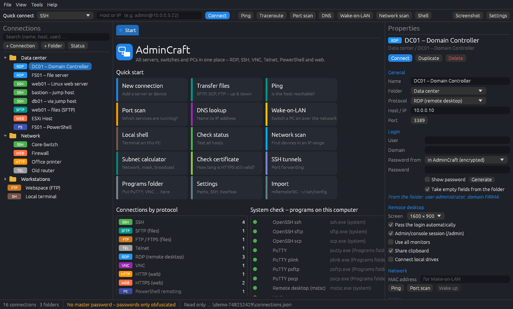
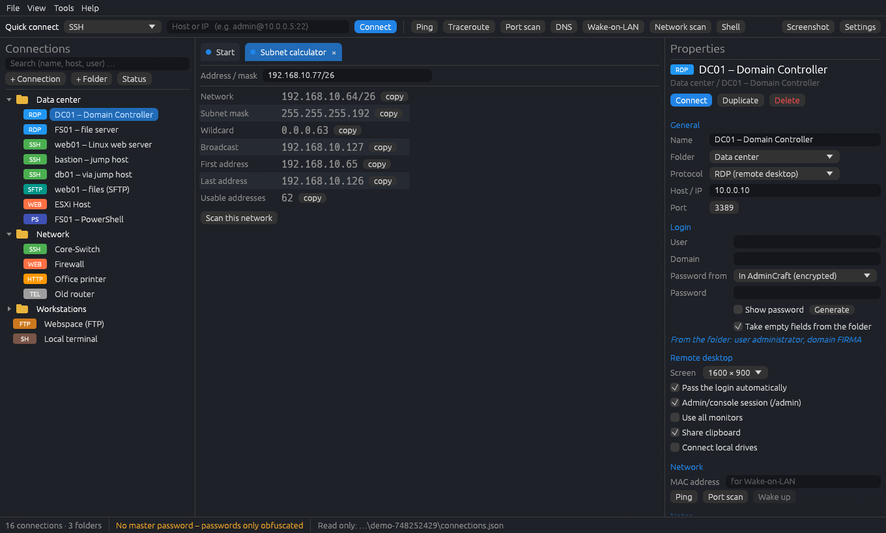
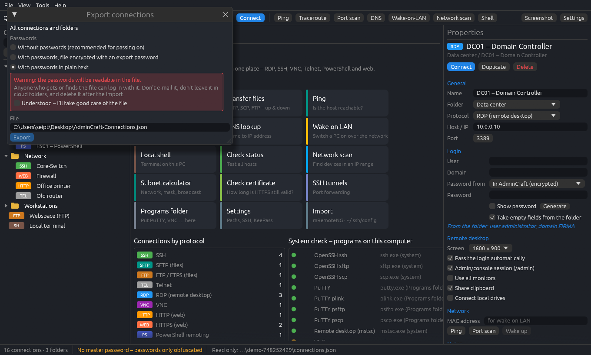

# AdminCraft-Handbuch

AdminCraft hält alle Server, Switches und PCs in einer Liste und öffnet sie per Doppelklick:
Remotedesktop, SSH, VNC, Telnet, PowerShell, Weboberflächen und Dateiübertragung, jeweils in einem eigenen Tab.
Dazu kommen die alltäglichen Werkzeuge eines Administrators: Ping, Port-Scan, Netzwerk-Scan, DNS,
Subnetz-Rechner, Zertifikatsprüfung und mehr.

Dieses Handbuch steckt auch im Programm: **Hilfe » Handbuch** oder **F1**.

## Das Fenster auf einen Blick



```
+---------------------------------------------------------------------------+
| Datei  Ansicht  Werkzeuge  Hilfe                                          |
| Schnellverbindung [SSH v] [Host oder IP] Verbinden | Ping  Port-Scan  ... |
+-----------------+-------------------------------------+-------------------+
| Verbindungen    |  [Start] [web01] [DC01] [Dateien]  <- Tabs              |
|  suchen ...     |                                     | Eigenschaften     |
|  > Rechenzentrum|   die offene Verbindung, ein Werk-  |  Name, Host,      |
|     DC01        |   zeug oder die Startseite          |  Login, Optionen  |
|     web01       |                                     |  der gewählten    |
|  > Netzwerk     |                                     |  Verbindung       |
+-----------------+-------------------------------------+-------------------+
| 16 Verbindungen · 3 Ordner | Masterpasswort-Status | wo die Liste liegt   |
+---------------------------------------------------------------------------+
```

- **Links: der Verbindungsbaum.** Ordner und Verbindungen. Doppelklick öffnet, Rechtsklick zeigt
  alles, was sich mit einem Eintrag machen lässt.
- **Mitte: die Tabs.** Jede offene Verbindung und jedes Werkzeug bekommt einen Tab. Der Tab **Start** zeigt Schnellstart-
  Karten, wie viele Verbindungen welches Protokoll nutzen und welche Hilfsprogramme gefunden wurden.
- **Rechts: die Eigenschaften.** Alles zur ausgewählten Verbindung oder zum ausgewählten Ordner. Änderungen werden nach
  einem Moment von selbst gespeichert.
- **Oben: die Schnellverbindung.** Protokoll wählen, `host`, `user@host` oder `user@host:port` eintippen, Enter drücken –
  für eine einmalige Verbindung, die nicht gespeichert werden soll.
- **Unten: die Statusleiste.** Anzahl der Verbindungen, ob ein Masterpasswort die Liste schützt,
  und wo die Liste gespeichert ist.

> Tipp: Ansicht » Eigenschaften anzeigen blendet die rechte Seite aus, wenn mehr Platz gebraucht wird.

## Die erste Verbindung

1. Auf **+ Verbindung** klicken (oder **Ctrl+Shift+N** drücken).
2. Rechts einen **Namen** vergeben, das **Protokoll** wählen (zum Beispiel SSH oder RDP) und den
   **Host oder die IP-Adresse** eintragen. Der Port wird automatisch ausgefüllt.
3. Unter **Anmeldung** den **Benutzer** und bei Bedarf das **Passwort** eintragen (siehe *Passwörter* unten).
4. Die Verbindung im Baum doppelt anklicken. Sie öffnet sich in einem neuen Tab.

Das ist alles. Mehrere ähnliche Server? Rechtsklick » **Kopieren / Duplizieren** und nur den Host ändern.

> Tipp: Die Beispielverbindungen in einer neuen Liste zeigen, was möglich ist. Sie lassen sich jederzeit löschen.

## Ordner und Ordnung

- **+ Ordner** legt einen Ordner an; Rechtsklick auf einen Ordner bietet **Neue Verbindung hier** und **Neuer Unterordner**.
- **Ziehen und Ablegen:** Eine Verbindung auf die obere oder untere Hälfte eines anderen Eintrags ziehen, um sie davor oder
  dahinter einzuordnen; auf die Mitte eines Ordners fallen lassen, um sie hineinzuschieben.
- Rechtsklick » **Nach oben / Nach unten** macht dasselbe über das Kontextmenü.
- **Suchen** über dem Baum (Ctrl+Shift+F) filtert nach Name, Host und Benutzer.

**Ordner geben Werte weiter.** Benutzer, Domäne und Passwort am Ordner eintragen – jede Verbindung darin,
bei der *Leere Felder vom Ordner übernehmen* eingeschaltet ist, nutzt sie. So wird das Admin-Passwort einmal am
Ordner geändert statt an fünfzig Servern. Die Eigenschaften zeigen in Blau, woher ein Wert stammt.

Rechtsklick auf einen Ordner » **Alle Verbindungen im Ordner öffnen** öffnet alle auf einmal.

## Protokolle: was sich wo öffnet

| Protokoll | Öffnet sich als | Benötigt |
|---|---|---|
| SSH | Terminal-Tab (oder PuTTY, oder eigenes Fenster) | OpenSSH (in Windows 10/11, macOS, Linux enthalten) oder PuTTY |
| RDP | Remotedesktop-Fenster im Tab (Windows) | `mstsc` (Windows), FreeRDP oder Remmina (Linux), Windows App (macOS) |
| VNC | Viewer-Fenster im Tab | einen VNC-Viewer wie TigerVNC oder TightVNC |
| Telnet | Terminal-Tab | — |
| PowerShell | Terminal-Tab mit `Enter-PSSession` | PowerShell, WinRM auf dem Ziel |
| HTTP / HTTPS | Browser-App-Fenster im Tab | Edge oder Chrome (sonst der normale Browser) |
| SFTP / SCP / FTP / FTPS | Dateiübertragungs-Tab | OpenSSH oder PuTTY für SFTP/SCP; FTP ist eingebaut |
| Seriell, Raw-TCP, rlogin | PuTTY im Tab oder ein Terminal-Tab | PuTTY/plink (Windows); picocom, nc … anderswo |
| Lokale Shell | Terminal-Tab auf diesem Computer | — |

**Fenster in Tabs.** Unter Windows werden Remotedesktop-, PuTTY-, VNC- und Webfenster in den
Tab gesetzt. Zum Tippen hineinklicken. **Als eigenes Fenster** löst eines wieder heraus, **Fokus** gibt ihm die Tastatur.
Unter Linux und macOS laufen diese Programme in eigenen Fenstern, und der Tab zeigt ihren Zustand.

**Der Terminal-Tab** versteht Farben und Vollbildprogramme (top, htop, mc, vim). Seine Werkzeugleiste bietet
**Neu verbinden**, **Befehle** (gespeicherte Befehle), **Text kopieren**, **Passwort senden** und **Strg+C**.

## Passwörter

Für jede Verbindung wird unter **Passwort aus** gewählt:

- **In AdminCraft (verschlüsselt)** – in der Liste gespeichert, verschlüsselt.
- **KeePass** – aus einer KeePass- oder KeePassXC-Datenbank gelesen (Eintrag nach Titel oder Pfad). AdminCraft fragt
  einmal pro Sitzung nach dem Datenbank-Passwort (Werkzeuge » KeePass entsperren).
- **Jedes Mal fragen** – es wird nichts gespeichert.

**Automatische Anmeldung:** Bei SSH und Telnet wird das Passwort eingetippt, sobald der Server danach fragt
(Einstellungen » *Gespeichertes Passwort im Terminal automatisch eingeben*). Bei RDP wird es für diese eine
Verbindung an Windows übergeben.

**Masterpasswort** (Einstellungen » Speicherort): Ohne es sind gespeicherte Passwörter nur verschleiert – wer
die Datei und AdminCraft hat, könnte sie lesen. Mit Masterpasswort sind sie richtig verschlüsselt
(AES-256-GCM, Argon2), und auf Wunsch lässt sich **Gesamte Liste mit dem Masterpasswort verschlüsseln** einschalten (auch Namen und Hosts).
AdminCraft fragt dann beim Start nach dem Masterpasswort.

> Wichtig: Ohne Masterpasswort gibt es keinen Weg zurück. Es an einem sicheren Ort notieren.

**2FA-Codes:** KeePass-Einträge mit TOTP-Geheimnis zeigen den aktuellen Code neben dem Passwort.
**Passwort-Generator:** Werkzeuge » Passwort-Generator oder die Schaltfläche *Erzeugen* neben einem Passwortfeld.

## Jump-Hosts

Manche Server sind nur über einen anderen Server erreichbar (einen „Jump-Host“ oder „Bastion-Host“).
Unter **Jump-Host** in den Eigenschaften des Ziels die Sprungverbindung und die Sprungart wählen:

- **Auf dem Jump-Host weiter: „ssh user@ziel“** – AdminCraft meldet sich am Jump-Host an und tippt dort `ssh user@target`
  ein. Richtig, wenn der SSH-Schlüssel für das Ziel **auf dem Jump-Host** liegt.
- **Tunnel durch den Jump-Host (ssh -J)** – der eigene Computer verbindet sich über den Jump-Host; der Schlüssel bleibt hier.

Jump-Hosts lassen sich verketten (ein Jump-Host kann selbst einen Jump-Host haben). Das funktioniert im Terminal-Tab,
mit PuTTY und in einem eigenen Fenster.

## Dateien übertragen

Rechtsklick auf eine SSH-Verbindung » **Dateien übertragen (SFTP)**, oder eine SFTP/SCP/FTP-Verbindung öffnen.

```
+------------------------------+------------------------------+
| Dieser Computer              | Server                       |
|  C:\Users\me\Downloads       |  /var/www                    |
|  report.pdf        -->       |  index.html                  |
|                    <--       |  logs/                       |
+------------------------------+------------------------------+
```

- Links der eigene Computer, rechts der Server. **Hochladen** und **Herunterladen** kopieren die ausgewählten Dateien oder Ordner.
- **Neuer Ordner**, **Umbenennen**, **Löschen** funktionieren auf beiden Seiten. Dateien lassen sich aus dem
  Dateimanager hineinziehen.
- Welche Programme die Arbeit machen, wird in Einstellungen » *Dateiübertragung mit* festgelegt (OpenSSH, psftp/pscp von PuTTY
  oder automatisch). FTP und FTPS (TLS) sind eingebaut.

## Werkzeuge für Administratoren

Alle Werkzeuge stehen im Menü **Werkzeuge**, in den Schaltflächen oben und im Rechtsklickmenü einer Verbindung
(dann ist der Host schon eingetragen).

- **Ping / Traceroute** – Ist der Host erreichbar, und welchen Weg nehmen die Pakete?
- **Port-Scan** – Welche Dienste antworten (SSH, RDP, HTTPS, SMB …)? Gängige Ports sind voreingestellt.
- **DNS-Abfrage** – A-, AAAA-, MX-, TXT-, CNAME-, NS-, SOA-, PTR-, SRV- und CAA-Einträge eines Namens.
- **Wake-on-LAN** – schaltet einen PC über das Netzwerk ein; dazu seine MAC-Adresse in den Eigenschaften eintragen.
- **Subnetz-Rechner** – `192.168.10.77/26` ergibt Netz, Maske, Broadcast, erste und letzte Adresse.
  Ein Klick scannt diesen Bereich.
- **Zertifikat prüfen** – wie viele Tage ein HTTPS-Zertifikat noch gilt, wer es ausgestellt hat, ob es vertrauenswürdig ist.
- **SSH-Tunnel** – Portweiterleitungen pro Verbindung (`lokaler Port → host:port` auf der Gegenseite),
  von Hand oder zusammen mit der Verbindung gestartet.
- **Status prüfen** (Schaltfläche über dem Baum) – testet den Port jeder Verbindung und färbt die Punkte im Baum.
- **Windows-Verwaltung** (Rechtsklick auf einen Windows-Server) – Dienste, Ereignisanzeige, Computerverwaltung,
  die Freigabe `C$`, **Neu starten** und **Herunterfahren** (mit Rückfrage). Linux-Server lassen sich über SSH neu starten.
- **Mehrfach-Eingabe** – dasselbe gleichzeitig in mehrere SSH-Tabs tippen (Werkzeuge » Mehrfach-Eingabe).
- **Gespeicherte Befehle** – im Terminal-Tab unter *Befehle*; Platzhalter `{host}` `{user}` `{name}`.

## Netzwerk-Scan



Der Netzwerk-Scan (Ctrl+Shift+L) durchsucht einen IP-Bereich nach Geräten, ähnlich wie Angry IP Scanner:

1. Einen Bereich eingeben: `192.168.1.0/24`, `10.0.0.1-50` oder `10.0.0.250-10.0.1.5`.
2. Die zu prüfenden Ports wählen und auf **Starten** klicken.
3. Jedes Gerät, das antwortet, zeigt Name, MAC-Adresse, Antwortzeit und offene Ports.

**Als Vergleichsstand speichern** merkt sich das Ergebnis. Der nächste Scan desselben Bereichs markiert jedes Gerät als
**NEU**, **WEG** oder **GEÄNDERT** (z. B. eine andere MAC-Adresse) – praktisch, um Fremde im Netzwerk zu entdecken.

**+ Verbindung** bei einem Ergebnis legt eine Verbindung im Ordner *Netzwerk-Scan* an; das Protokoll
aus der Liste wählen.

## Weitergeben und zentral speichern



**Export für Kollegen** (Datei » Verbindungen exportieren, oder Rechtsklick auf einen Ordner » Ordner exportieren):

- **Ohne Passwörter** – die sichere Voreinstellung.
- **Mit Passwörtern, Datei mit Export-Passwort verschlüsselt** – dem Kollegen das Passwort auf anderem Weg sagen (Telefon).
- **Mit Passwörtern im Klartext** – nur nach einer deutlichen Warnung; wer die Datei bekommt, kann die Passwörter lesen.

**Importieren** mit Datei » AdminCraft-Export importieren. Importierte Einträge landen in einem eigenen Ordner.

**Zentrale Liste fürs Team** (Einstellungen » Speicherort): Die Liste auf einer **Netzwerkfreigabe** ablegen (SMB,
z. B. `\\server\it\AdminCraft-Connections.json`) oder auf einem **WebDAV-Server** (Nextcloud, ownCloud, IIS).
Mit dem Masterpasswort schützen. Ändert ein Kollege etwas, lädt AdminCraft es neu.

**Umstieg von anderen Werkzeugen:** Datei » mRemoteNG-Datei importieren (`confCons.xml`, mit Passwörtern) und
Datei » OpenSSH-Konfiguration importieren (`~/.ssh/config`, einschließlich ProxyJump).

## Einstellungen

Öffnen über die Schaltfläche **Einstellungen**, **Ctrl+,** oder Werkzeuge » Einstellungen.

- **Sprache** – standardmäßig die Systemsprache; jederzeit umschaltbar.
- **Darstellung** – dunkel oder hell, Größe der Terminal-Schrift.
- **SSH, Remotedesktop und Dateien** – welcher Client SSH öffnet (eingebautes Terminal, PuTTY, eigenes Fenster),
  welche Programme Dateien übertragen, ob Fenster in Tabs eingebettet werden.
- **Programme** – wo AdminCraft die einzelnen Hilfsprogramme gefunden hat. Einen eigenen Pfad angeben oder einfach
  portable Programme in den **Programme-Ordner** legen (`AdminCraftTools` neben AdminCraft).
- **Speicherort** – wo die Liste liegt, Masterpasswort, zentrale Speicherung.
- **Passwort-Tresor** – die zu verwendende KeePass-Datenbank.

## Portabel: alles neben dem Programm

AdminCraft ist eine einzige Datei. Alles, was es speichert, liegt in Ordnern daneben:

```
AdminCraft.exe
AdminCraftData\     Verbindungen, Scan-Vergleichsstände, Sitzungsprotokolle
AdminCraftTools\    selbst hineingelegte Hilfsprogramme (putty.exe, vncviewer.exe …)
AdminCraftLang\     eigene Sprachdateien
```

Den Ordner auf einen USB-Stick kopieren, und der ganze Werkzeugkasten ist immer dabei. Lässt sich der Ordner nicht beschreiben
(zum Beispiel innerhalb einer macOS-App), nutzt AdminCraft stattdessen `.admincraft` im eigenen Benutzerordner.

AdminCraft kontaktiert von sich aus nichts im Internet – nur die Hosts, mit denen man sich verbindet.

## Sprachen

Englisch, Deutsch, Französisch, Italienisch und Ukrainisch sind eingebaut. Um eine Sprache hinzuzufügen oder zu verbessern:

1. Einstellungen » Sprache » **Sprachordner öffnen**.
2. `de.lang.example` z. B. nach `es.lang` kopieren, oben `@name` und `@code` setzen.
3. In jeder Zeile den Text rechts von ` = ` übersetzen. Die linke Seite ist das englische Original und bleibt.
   `{0}`, `{1}` sind Platzhalter und müssen bleiben.
4. Die Sprache in den Einstellungen wählen.

Eine Datei dort mit dem Code einer eingebauten Sprache (z. B. `fr.lang`) verbessert diese Sprache.
Dieses Handbuch lässt sich genauso übersetzen: als `help-xx.md` im Sprachordner speichern.

## Tastenkürzel

| Tasten | Was |
|---|---|
| Ctrl+Tab / Ctrl+Shift+Tab | nächster / vorheriger Tab |
| Ctrl+Shift+W | Tab schließen |
| Ctrl+Shift+N | neue Verbindung |
| Ctrl+Shift+F | Verbindungen durchsuchen |
| Ctrl+Shift+S | Bildschirmfoto des Tabs in die Zwischenablage |
| Ctrl+Shift+E | Verbindungen exportieren |
| Ctrl+Shift+L | Netzwerk-Scan |
| Ctrl+, | Einstellungen |
| F1 | dieses Handbuch |
| Doppelklick | Verbindung öffnen / Tab umbenennen |
| Mittlere Maustaste | Tab schließen |

Die Kürzel nutzen Shift, damit Programme im Terminal-Tab ihre eigenen Ctrl-Tasten behalten. Unter macOS Cmd
statt Ctrl verwenden. Tabs lassen sich zum Umsortieren ziehen; Rechtsklick auf einen Tab benennt ihn um.

## Für Skripte und KI-Agenten

Dieselben Werkzeuge funktionieren ohne Fenster und geben JSON aus. Passwörter werden nie zurückgegeben.

```
admincraft cli list [filter]          gespeicherte Verbindungen
admincraft cli scan 192.168.1.0/24    Netzwerk-Scan, verglichen mit dem gespeicherten Vergleichsstand
admincraft cli ports <host> [ports]   Port-Scan
admincraft cli dns <name>             DNS-Abfrage
admincraft cli subnet <cidr>          Subnetz-Rechner
admincraft cli cert <host> [port]     Zertifikatsprüfung
admincraft cli open <name>            eine Verbindung im Fenster öffnen
admincraft mcp                        MCP-Server für KI-Assistenten (stdin/stdout)
```

## Fragen und Probleme

**„Programm nicht gefunden“** – Der Tab Start zeigt unter *Systemcheck*, welche Hilfsprogramme fehlen. Diese installieren,
einen Pfad in Einstellungen » Programme angeben oder sie in den Programme-Ordner legen und auf *Neu suchen* klicken.

**SSH: „Remote side unexpectedly closed network connection“ hinter einem Jump-Host** – Der Schlüssel für das
Ziel liegt vermutlich auf dem Jump-Host. Als Sprungart *Auf dem Jump-Host weiter* wählen.

**Das Remotedesktop-Fenster erscheint nicht im Tab** – Ein paar Sekunden warten (Zertifikatsfragen
kommen zuerst als eigenes Fenster), dann auf *Neu verbinden* klicken. Einstellungen » *RDP-, PuTTY- und VNC-Fenster in den Tab einbetten*
schaltet das Einbetten ab.

**Masterpasswort vergessen** – Die verschlüsselten Passwörter lassen sich nicht wiederherstellen. Mit einer leeren Liste beginnen
(die Datei in `AdminCraftData` wegschieben) und einen Export importieren.

**Wo sind meine Daten?** – Datei » Datenordner öffnen.
